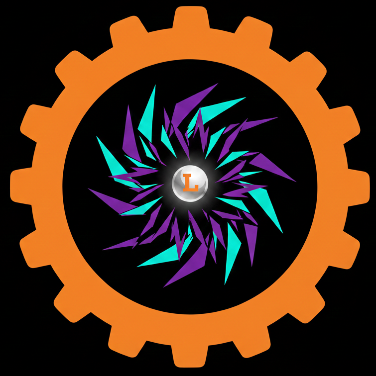
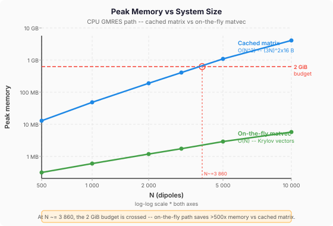

<p align="center">
  
</p>

<h1 align="center">Lumina</h1>

[](https://www.rust-lang.org/)
[](LICENSE)
[](https://github.com/jonesrobm/lumina)
[](docs/)
[](https://ko-fi.com/jonesrobm)

> High-performance electromagnetic simulations for nanophotonics using the Coupled Dipole Approximation

Lumina is a Rust framework for computing the linear and nonlinear optical response of nanostructured materials. It implements the Coupled Dipole Approximation (CDA) with state-of-the-art numerical methods and GPU acceleration, providing accurate cross-sections, near-field maps, and SHG/THG spectra for metallic and dielectric nanoparticles — from simple spheres to complex periodic metasurfaces on substrates.

<p align="center">
  
</p>

<p align="center">
  <em>Interactive GUI dashboard with real-time spectra, near-field heatmaps, and dipole lattice preview</em>
</p>

---

## What's New in v0.4.1

- **O(N) memory GMRES** — on-the-fly matvec evaluates G(rᵢ,rⱼ)·xⱼ per iteration without ever assembling the 3N×3N matrix; peak memory drops from ~1.3 GB to ~4 MB at N = 3 000
- **GPU budget gate** — the `matrix_memory_budget` check now fires *before* GPU assembly, so large-N systems go directly to on-the-fly rather than silently doing an O(N²) CPU allocation
- **1D chain Ewald fix** — the previous implementation zeroed all inter-cell interactions (erfc ≈ 10⁻¹⁰⁹ at the nearest image); 1D chains now use a correct direct lattice sum with ≥ 20 shells
- **Extended Palik library** — Al₂O₃ (sapphire), Si (crystalline, 400–1100 nm), GaAs (300–1000 nm) added alongside TiO₂ and SiO₂
- **136 tests passing**

<details>
<summary>v0.4.0 highlights</summary>

- **SHG & THG** — self-consistent second- and third-harmonic generation via χ^(2) and χ^(3) tensors
- **Full Ewald acceleration** — erfc-damped real-space sum + 2D spectral reciprocal-space sum for periodic arrays
- **Retarded substrate** — retarded normal-incidence Fresnel amplitude replaces the quasi-static Δε
</details>

---

## Features

### Physics

- Full dyadic Green's function with Filtered Coupled Dipole (FCD) near-field correction
- Clausius–Mossotti polarisability with radiative reaction correction (RRCM)
- Anisotropic 3×3 polarisability tensors for ellipsoidal particles (depolarisation factors via 16-point Gauss–Legendre quadrature)
- CoreShell geometry with arbitrary concentric layers, each with independent material
- **Substrate image-dipole** — retarded normal-incidence Fresnel amplitude (default) or quasi-static Δε
- **Periodic lattice sums** — full Ewald split: erfc-damped real-space + 2D spectral reciprocal-space sum; Bloch wavevector support
- **SHG** — χ^(2) tensors (isotropic surface C_∞v or custom); self-consistent solve at 2ω; intensity ∝ |E|⁴
- **THG** — χ^(3) tensors (isotropic bulk or custom); self-consistent solve at 3ω; intensity ∝ |E|⁶
- Far-field radiation patterns at ω, 2ω, 3ω (E-plane / H-plane polar plots)
- Circular dichroism ΔC_ext for chiral structures
- Near-field |E|² maps on arbitrary observation planes
- Validated against Mie theory: < 15% for dielectrics, < 30% for Au interband region

### Solvers

- Direct LU decomposition (`faer`) for N ≤ 1000 dipoles
- GMRES(m=30) iterative solver for N > 1000 (agrees with direct to 10⁻¹³ relative error)
- **On-the-fly matvec** — computes G(rᵢ,rⱼ)·xⱼ per iteration with no matrix assembly; O(N) peak memory, runs on any laptop at N = 10 000
- Configurable `matrix_memory_budget` (default 2 GiB) — automatically selects cached or on-the-fly path based on matrix size
- GPU-accelerated GMRES matvec via wgpu compute shaders (optional, `--features gpu`)
- Persistent GPU session buffers — matrix uploaded once per wavelength solve
- Rayon-parallel wavelength sweep across all CPU cores (GUI and CLI)

### Materials

- Johnson & Christy (1972): Au, Ag, Cu — 43 data points, 188–892 nm (`Au_JC`, `Ag_JC`, `Cu_JC`)
- Palik handbook: TiO₂, SiO₂, Al₂O₃ (300–1000 nm), Si (400–1100 nm), GaAs (300–1000 nm) (`TiO2_Palik`, …)
- Rakić et al. (1998) Lorentz–Drude models for Ag, Al, Au, Be, Cr, Cu, Ni, Pd, Pt, Ti, W (`Ag_LD`, …, `W_LD`), analytic, valid over each fit's range (207–12 398 nm at most; see `lumina-cli materials`)
- Cubic spline interpolation for smooth ε(λ) from tabulated data; wavelengths outside a material's range are refused

### Geometry

- Primitives: sphere, cylinder, cuboid, ellipsoid, helix
- CoreShell: sphere/cylinder/cuboid/ellipsoid core with any number of shell layers
- `.xyz` import — treat each atom as a dipole (Å→nm conversion; `dipole_spacing` sets the volume per atom)
- `.obj` mesh import — volume-filling dipole lattice via ray-casting
- Multi-object scenes: independent position, rotation (Euler XYZ), and scale per object
- Supplied example: Au Mackay icosahedron (k=6, 923 atoms, `examples/au_icosahedron_k6.xyz`)

---

## Installation

### Prerequisites

- Rust 1.75 or later ([rustup.rs](https://rustup.rs))
- (GPU only) A Vulkan/Metal/DX12-capable GPU driver — no additional SDK required

### Build (CPU only)

```bash
git clone https://github.com/JonesRobM/lumina.git
cd lumina
cargo build --release
```

### Build with GPU acceleration

```bash
cargo build --release --features gpu
```

The `gpu` feature enables wgpu compute shaders for GMRES matrix-vector products. The build otherwise identical — no CUDA toolkit, no separate driver installation. GPU is used automatically when available; falls back to CPU otherwise.

---

## Quick Start: GUI

```bash
cargo run --release -p lumina-gui
# with GPU:
cargo run --release -p lumina-gui --features gpu
```

The GUI has three panels:

| Panel | Purpose |
|-------|---------|
| **Scene** | Define geometry objects, materials, file imports, and transforms |
| **Simulation** | Set wavelength range, environment, polarisation, substrate, and compute backend |
| **Results** | View spectra (C_ext/C_abs/C_sca), near-field heatmap, far-field polar plot, export CSV/JSON |

**Typical workflow:**
1. **Scene panel** — add an object (`+`), choose shape type, set radius/semi-axes/etc., choose material, set dipole spacing
2. **Simulation panel** — set wavelength range (e.g. 400–900 nm, 100 points), environment refractive index
3. Optionally enable **Substrate** (material + interface z-position) or **GPU**
4. Click **Run Simulation** — progress bar tracks the parallel wavelength sweep
5. **Results panel** appears automatically on completion

---

## Quick Start: CLI

Create a TOML configuration file and pass it to `lumina-cli`:

```bash
cargo run --release -p lumina-cli -- run job.toml
# with GPU:
cargo run --release -p lumina-cli --features gpu -- run job.toml
```

### Minimal example — gold nanosphere

Save as `gold_sphere.toml`:

```toml
[simulation]
wavelengths = { range = [400.0, 850.0], points = 91 }
environment_n = 1.0

[[geometry.object]]
name = "Au_sphere"
material = "Au_JC"
dipole_spacing = 2.0          # nm; each dipole is a cube of this side

[geometry.object.shape]
type = "sphere"
radius = 20.0                 # nm

[output]
directory = "./output"
save_spectra = true
```

Run:

```bash
cargo run --release -p lumina-cli -- run gold_sphere.toml
cargo run --release -p lumina-cli -- validate gold_sphere.toml   # parse and check only
cargo run --release -p lumina-cli -- materials                   # material identifiers and ranges
```

Output in `./output/spectra.csv` (cross-sections in nm²):

```
# Lumina CDA Solver — Cross-Section Spectra
# Version: 0.3.0
# environment_n: 1
# object 'Au_sphere': material=Au_JC, dipole_spacing=2 nm
#
wavelength_nm,extinction_nm2,absorption_nm2,scattering_nm2
400.00,...
```

### Job file reference

| Table / key | Meaning |
|---|---|
| `[simulation]` `wavelengths` | `{ range = [start, end], points = n }` or `{ values = [...] }`, in nm |
| `environment_n` | Refractive index of the surrounding medium (default 1.0) |
| `solver_tolerance`, `max_iterations` | GMRES settings (used for N > 1000 dipoles) |
| `backend` | `"auto"` (default), `"cpu"` or `"gpu"` |
| `matrix_memory_gib` | Budget for caching the interaction matrix (default 2.0) |
| `[simulation.substrate]` | Optional: `material`, `z_interface` (nm), `use_retarded` (default true), `use_sommerfeld` |
| `[[geometry.object]]` | One per object: `name`, `material`, `dipole_spacing` (nm, must be > 0), optional `position` (nm), `rotation_deg`, `scale` |
| `[geometry.object.shape]` | `type` = `sphere` \| `cylinder` \| `cuboid` \| `ellipsoid` \| `helix` \| `coreshell` \| `file`, plus that shape's keys |
| `[geometry.object.species_map]` | For `.xyz` imports: element label → material identifier |
| `[output]` | `directory`, `save_spectra`, `save_json`, `save_near_field` |
| `[nonlinear]` | Optional SHG/THG settings (below) |

Points worth knowing:

- **Placement keys sit directly on the object** (`position = [x, y, z]`,
  `rotation_deg = [rx, ry, rz]`, `scale = 1.0`); there is no `transform`
  subtable. The transform is scale → rotate → translate, with
  R = Rz(rz)·Ry(ry)·Rx(rx) in degrees. Every shape is centred on the origin
  before the transform.
- **Unknown keys are ignored**, not rejected, so a misspelt or misplaced key
  silently has no effect. `lumina-cli validate` only checks that the file parses.
- **`dipole_spacing` is a volume, not just a grid step.** Each dipole's
  Clausius–Mossotti polarisability uses the volume `dipole_spacing³`, and the
  filtered Green's function (FCD) uses the same value as its cell size. Zero,
  negative or NaN spacings are rejected. `scale` moves dipoles but does not
  change their volume.
- **Incident field is fixed in the CLI**: a plane wave travelling along +z,
  polarised along x. To probe other directions, rotate the object instead
  (see *Orientation averaging* below). The GUI additionally offers y and
  circular polarisation.
- **Materials**: `lumina-cli materials` lists every identifier with its valid
  wavelength range. Asking for a wavelength outside that range is an error,
  never an extrapolation.
- Periodic lattices (Ewald sums) are available through the library API
  (`CdaSolver::lattice`), not from CLI job files.

### Core-shell particle on a glass substrate

```toml
[simulation]
wavelengths = { range = [400.0, 850.0], points = 150 }
environment_n = 1.33          # water

[simulation.substrate]
material = "SiO2_Palik"
z_interface = -22.0           # nm — just below the particle

[[geometry.object]]
name = "Au-SiO2_core-shell"
material = "Au_JC"            # required; the shape's own materials take precedence
dipole_spacing = 2.0

[geometry.object.shape]
type = "coreshell"
core_material = "Au_JC"

[geometry.object.shape.base]
type = "sphere"
radius = 15.0                 # nm Au core

[[geometry.object.shape.shells]]
thickness = 5.0               # nm SiO2 shell
material = "SiO2_Palik"

[output]
directory = "./output/coreshell"
save_near_field = true
```

The SiO₂ data stop at 1000 nm, and the substrate material is evaluated at every
wavelength, so keep the sweep inside both materials' ranges.

### Anisotropic ellipsoids

Ellipsoidal objects automatically use a per-dipole 3×3 polarisability tensor:

```toml
[[geometry.object]]
name = "Au_nanorod"
material = "Au_JC"
dipole_spacing = 2.0
rotation_deg = [0.0, 45.0, 0.0]   # tilt 45° about y

[geometry.object.shape]
type = "ellipsoid"
semi_axes = [30.0, 8.0, 8.0]      # prolate: long axis along x before rotation
```

Depolarisation factors L_x, L_y, L_z are computed via 16-point Gauss–Legendre quadrature (exact for spheres, ~1 ppm for aspect ratios up to 20:1).

### Multi-object dimers

```toml
[[geometry.object]]
name = "particle_A"
material = "Au_JC"
dipole_spacing = 2.0
position = [-20.0, 0.0, 0.0]

[geometry.object.shape]
type = "sphere"
radius = 15.0

[[geometry.object]]
name = "particle_B"
material = "Au_JC"
dipole_spacing = 2.0
position = [20.0, 0.0, 0.0]

[geometry.object.shape]
type = "sphere"
radius = 15.0
```

Give every object the same `dipole_spacing`: the filtered Green's function
needs a single cell size, so the CLI falls back to plain point-dipole
interactions (and says so) when spacings differ.

### SHG & THG (nonlinear optics)

```toml
[simulation]
wavelengths = { range = [500.0, 850.0], points = 71 }

[[geometry.object]]
name = "Au_sphere"
material = "Au_JC"
dipole_spacing = 2.0

[geometry.object.shape]
type = "sphere"
radius = 20.0

[nonlinear]
enable_shg = true
symmetry = "isotropic_surface"
chi_zzz = [1.0, 0.0]   # nm³
chi_zxx = [0.3, 0.0]

enable_thg = true
chi3_symmetry = "isotropic_bulk"
chi3_xxxx = [0.5, 0.0]   # nm⁶
chi3_xxyy = [0.1, 0.0]
```

Outputs: `spectra.csv`, `shg_spectrum.csv` (intensity in nm⁶), `thg_spectrum.csv` (intensity in nm⁹).
The material must also cover λ/2 (SHG) and λ/3 (THG); wavelengths where it does not are skipped.

### Atomistic import (`.xyz`)

```toml
[[geometry.object]]
name = "Au_icosahedron"
material = "Au_JC"            # used for any element not in species_map
dipole_spacing = 0.2569       # nm = (bulk volume per Au atom)^(1/3)

[geometry.object.shape]
type = "file"
path = "examples/au_icosahedron_k6.xyz"   # relative to the directory you run from

[geometry.object.species_map]
Au = "Au_JC"
```

- `type = "file"` accepts `.xyz` (atomistic: one dipole per atom) and `.obj`
  (a closed mesh, filled with a cubic dipole lattice at `dipole_spacing`).
  Any other extension is an error.
- `.xyz` coordinates are read in ångström and converted to nm; the structure is
  re-centred on its centroid.
- `species_map` is a subtable of the object, keyed by the element label in the
  `.xyz` file. Unmapped labels use the object's `material`.
- **Choose `dipole_spacing` so that `dipole_spacing³` is the volume per atom.**
  There is no auto-detection. For an fcc metal with lattice constant *a* the
  volume per atom is *a*³/4, so `dipole_spacing = a / 4^(1/3)`:

  | Metal | a (Å) | `dipole_spacing` (nm) |
  |---|---|---|
  | Au | 4.078 | 0.2569 |
  | Ag | 4.085 | 0.2574 |
  | Cu | 3.615 | 0.2277 |
  | Al | 4.050 | 0.2551 |
  | Pt | 3.924 | 0.2472 |
  | Pd | 3.891 | 0.2451 |
  | Ni | 3.524 | 0.2220 |

- Treating each atom as a Clausius–Mossotti sphere with bulk ε is an
  approximation. For gold clusters of ~1000 atoms it reproduces Mie theory
  near the plasmon to ~10%, but it puts a few per cent of the oscillator
  strength into discrete modes red of the plasmon, so absorption beyond
  ~600 nm comes out several times larger than Mie and can wiggle or rise
  towards the near-infrared. Do not read physics into that tail without a
  convergence check.

### Orientation averaging

The CLI always illuminates along +z with x polarisation, so the spectrum
reports the response to a field along the object's lab-frame x axis. For a
particle much smaller than the wavelength, the orientation-averaged
extinction and absorption are the mean of three runs that put each of the
object's own axes along x:

| Run | `rotation_deg` | Object axis along the field |
|---|---|---|
| 1 | `[0.0, 0.0, 0.0]` | x |
| 2 | `[0.0, 0.0, 90.0]` | y |
| 3 | `[0.0, 90.0, 0.0]` | z |

C_avg = (C₁ + C₂ + C₃)/3. This is exact in the dipole (quasi-static) limit,
where the response is the trace of a polarisability tensor. For larger
particles, average over many orientations (e.g. random or Lebedev-quadrature
Euler angles, including a rotation about z to sample the polarisation).

---

## GPU Acceleration

Build and run with GPU support:

```bash
# GUI
cargo run --release -p lumina-gui --features gpu

# CLI
cargo run --release -p lumina-cli --features gpu -- run job.toml
```

In the GUI, toggle **GPU** in the Simulation panel. In the CLI TOML:

```toml
[simulation]
backend = "gpu"    # "auto" (default) | "cpu" | "gpu"
```

**Implementation details:**
- wgpu compute shaders (Vulkan/Metal/DX12 — no CUDA required)
- Matrix assembled on CPU (Rayon), matvec offloaded to GPU for all GMRES iterations
- Persistent session buffers: matrix written to GPU once per wavelength, reused for all ~300 GMRES iterations
- GPU uses f32 arithmetic; Arnoldi vectors and Givens rotations stay f64 on CPU
- GMRES residual floor on GPU: ~1e-7 (use `solver_tolerance = 1e-6`)
- At N ≤ 3000, GPU is slower than CPU due to transfer overhead; speedup expected at N > 5000

### How the solver picks its path

The solver automatically selects the lowest-memory strategy that fits the configured budget:

<p align="center">
  
</p>

For large N, the interaction matrix grows as (3N)² × 16 bytes — 14.4 GB at N = 10 000. The `matrix_memory_budget` (default 2 GiB) gates both the GPU and CPU-cached paths, so large problems automatically fall through to the on-the-fly path without ever allocating the matrix.

### Memory scaling

<p align="center">
  
</p>

| N | Cached matrix | On-the-fly |
|---|---------------|-----------|
| 1 000 | 144 MB | ~1.5 MB |
| 3 000 | 1.3 GB | ~4.6 MB |
| 10 000 | 14.4 GB | ~15 MB |

The crossover from cached to on-the-fly occurs at N ≈ 3 860 (2 GiB default budget). Override in TOML:

```toml
[simulation]
matrix_memory_gib = 8.0   # increase to cache larger matrices
matrix_memory_gib = 0.0   # always use on-the-fly (lowest memory)
```

---

## Validation

Lumina is benchmarked against analytical Mie theory:

<p align="center">
  
</p>

| Material | Wavelength range | CDA error |
|----------|-----------------|-----------|
| Dielectric (TiO₂-like, ε = 4 + 0i) | 500–700 nm | < 15% |
| Lossy dielectric (ε = 4 + 0.5i) | 500–700 nm | < 16% |
| Au interband (FCD, d = 2 nm) | 420–510 nm | < 25% |
| Au Drude (> 550 nm) | 550+ nm | > 80%* |

*The Drude region error is a known limitation of the point-dipole staircase approximation on coarse grids. Surface averaging is planned for a future release.

Run the full test suite:

```bash
cargo test --workspace
```

---

## Roadmap

### Released

| Version | Highlights |
|---------|-----------|
| v0.1.0 | Linear solver, GUI, CLI, Mie validation |
| v0.1.1 | GMRES, FCD Green's function, cylinder/helix geometry |
| v0.1.2 | Spectra plots, near-field heatmaps, dipole scatter preview |
| v0.1.3 | Far-field patterns, circular dichroism, CSV/JSON export, Palik data, OBJ/XYZ import |
| v0.2.0 | GPU compute engine (wgpu), matrix-free GMRES, Rayon parallel assembly |
| v0.2.1 | Parallel wavelength sweep, stack-allocated Green's tensors, XYZ workflow, debug output |
| v0.2.2 | Persistent GPU session buffers, SceneSpec multi-object assembly |
| v0.3.0 | CoreShell geometry, anisotropic ellipsoid dipoles, substrate image-dipole, periodic lattice sums |
| v0.4.0 | Full Ewald acceleration, retarded substrate, SHG (χ^(2)), THG (χ^(3)) |
| **v0.4.1** | **O(N) on-the-fly matvec, GPU budget gate, 1D chain Ewald fix, extended Palik (Al₂O₃/Si/GaAs)** |

### Planned

| Version | Highlights |
|---------|-----------|
| v0.5.0 | DFT tensor import (VASP/Gaussian), full Sommerfeld substrate, MPI |
| v1.0.0 | BEM solver, T-matrix solver, FDTD, CUDA/Metal backends |

---

## Architecture

Lumina is a Rust workspace with six crates:

```
lumina/
├── lumina-core        # CDA solver, Green's functions, cross-sections, substrate, Ewald
├── lumina-compute     # ComputeBackend trait: CPU (Rayon) and GPU (wgpu)
├── lumina-geometry    # Scene assembly, primitives, discretisation, OBJ/XYZ parsers
├── lumina-materials   # MaterialProvider trait: J&C, Palik, spline interpolation
├── lumina-gui         # egui/eframe interactive dashboard
└── lumina-cli         # TOML-based batch processing
```

Key abstractions:
- `OpticalSolver` — CDA today; BEM/FDTD/T-matrix plug in via the same trait
- `ComputeBackend` — CPU (Rayon) default; GPU (wgpu) feature-gated
- `MaterialProvider` — returns ε(λ) for any material source
- `SceneSpec` — unified GUI/CLI scene description, serialisable to/from TOML

---

## Documentation

Full documentation is built with mdBook:

```bash
cd docs && mdbook serve --open
```

Key sections:
- [Theory](docs/src/theory/cda.md) — CDA formulation, polarisability prescriptions, anisotropic dipoles
- [Periodic Structures](docs/src/theory/periodic.md) — Ewald summation, Bloch conditions
- [Geometry & Shapes](docs/src/user-guide/geometry.md) — all shape types, CoreShell, transforms
- [Configuration](docs/src/user-guide/configuration.md) — full TOML reference
- [Validation](docs/src/theory/validation.md) — Mie benchmarks and accuracy analysis
- [Roadmap](docs/src/roadmap/versions.md) — version history and future plans

---

## Contributing

Contributions are welcome. See [CONTRIBUTING.md](CONTRIBUTING.md) for guidelines.

Priority areas:
- Surface-averaging methods for improved metallic convergence
- DFT polarisability import (VASP WAVEDER, Gaussian)
- Full Sommerfeld substrate (k∥-dependent Fresnel coefficients)
- GPU matrix assembly shader (currently CPU only)
- 1D Bessel spectral sum (K₀/K₁) for < 1% on-axis chain accuracy

---

## Citation

If you use Lumina in your research, please cite:

```bibtex
@software{lumina2026,
  author  = {Jones, Robert M.},
  title   = {Lumina: Coupled Dipole Approximation for Nanophotonics},
  year    = {2026},
  url     = {https://github.com/jonesrobm/lumina},
  version = {0.4.1}
}
```

Key references:
- Purcell, E. M. & Pennypacker, C. R., *Astrophys. J.* **186**, 705 (1973) — original DDA
- Draine, B. T. & Flatau, P. J., *J. Opt. Soc. Am. A* **11**, 1491 (1994) — DDSCAT
- Johnson, P. B. & Christy, R. W., *Phys. Rev. B* **6**, 4370 (1972) — Au/Ag/Cu optical data

---

## License

Apache License 2.0. See [LICENSE](LICENSE) for details.

---

## Support Development

[](https://ko-fi.com/jonesrobm)

---

## Acknowledgements

- The King's College London [Photonics & Nanotechnology Group](https://www.kcl.ac.uk/research/photonics-nanotechnology)
- **DDSCAT** (Draine & Flatau) and **ADDA** (Yurkin & Hoekstra) for pioneering the CDA/DDA method
- The Rust community for exceptional tooling and the `egui`, `wgpu`, `rayon`, and `faer` crates
- Johnson & Christy for the gold standard in optical constants

---

**Maintained by [Robert M. Jones](https://ko-fi.com/jonesrobm)**
